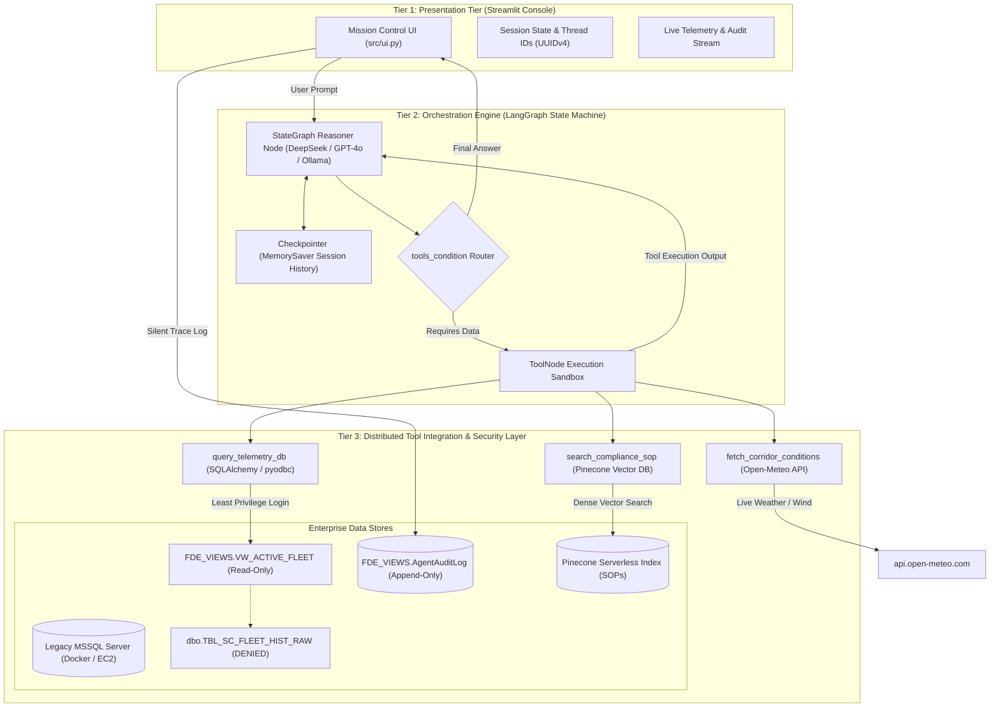
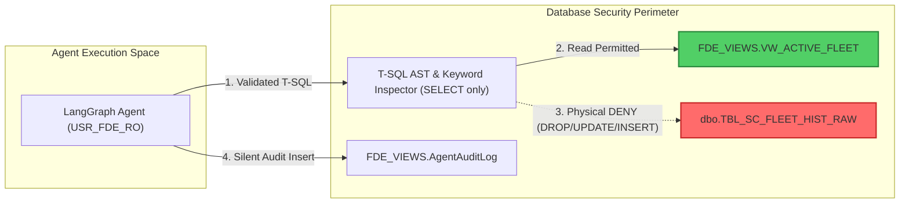
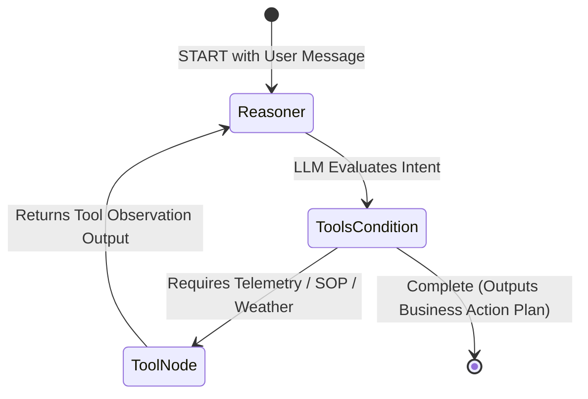

# 🧊 Enterprise Cold-Chain Logistics AI Assistant
### *Autonomous Fleet Control Tower, Agentic ReAct Orchestrator & Zero-Trust Telemetry Dispatcher*

[](https://www.python.org/)
[](https://langchain-ai.github.io/langgraph/)
[](https://streamlit.io/)
[](https://www.pinecone.io/)
[](https://www.docker.com/)
[](https://opensource.org/licenses/MIT)

> **Forward Deployed Engineering (FDE) Capstone Project**  
> Developed as a production-grade enterprise deployment bridging legacy supply-chain databases with agentic LLM reasoning loops, real-time corridor IoT telemetry, zero-trust RBAC database security, and automated standard operating procedure (SOP) compliance.
>
> 📽️ **Implementation Reference:** Based on the end-to-end architectural blueprint from [Complete End To End AI Forward Deployed Engineer (FDE) Project Implementation](https://youtu.be/FSZhPDzESPU).

---

## 📑 Table of Contents
- [Executive Overview](#-executive-overview)
- [The Forward Deployed Engineering (FDE) Problem](#-the-forward-deployed-engineering-fde-problem)
- [System Architecture (HLD & LLD)](#-system-architecture-hld--lld)
- [Enterprise Security & Zero-Trust Governance](#-enterprise-security--zero-trust-governance)
- [High-Density RAG & Vector Engine](#-high-density-rag--vector-engine)
- [Agentic ReAct Orchestrator & Tool Contracts](#-agentic-react-orchestrator--tool-contracts)
- [Interactive Control Tower Console](#-interactive-control-tower-console)
- [100% Free Deployment Playbook ($0 Cost)](#-100-free-deployment-playbook-0-cost)
- [Local 5-Minute Quickstart](#-local-5-minute-quickstart)
- [Repository File Tree](#-repository-file-tree)
- [Verification & Golden Evaluation Scenarios](#-verification--golden-evaluation-scenarios)
- [Interview & Resume Impact Portfolio](#-interview--resume-impact-portfolio)

---

## 🔭 Executive Overview

In global cold-chain logistics (pharmaceuticals, biological vaccines, and perishable food transit), temperature excursions and transit bottlenecks result in over **\$35 Billion in annual cargo losses**. 

While modern fleets are equipped with IoT telemetry sensors, control tower dispatchers face a critical operational bottleneck:
1. **Data Silos:** Sensor telemetry is trapped inside 20-year-old legacy relational schemas (`TBL_SC_FLEET_HIST_RAW`) with cryptic column keys.
2. **Unstructured Knowledge:** Standard Operating Procedures (SOPs), emergency triage rules, and regulatory temperature bands reside in static Markdown and PDF documents.
3. **Decoupled Real-Time Hazards:** Meteorological disturbances, corridor wind risks, and transit congestion live in disparate external REST APIs.

### The FDE Solution
This repository implements an autonomous **Cold-Chain AI Assistant & Control Tower**. Powered by **LangGraph**, **Pinecone Serverless**, and **Streamlit**, it allows enterprise dispatchers to converse directly with real-time operational data, cross-reference external environmental hazards, and automatically execute cited regulatory SOP action plans—all enforced by **strict Zero-Trust database access controls**.

```
Dispatcher Query ──► [LangGraph ReAct Brain]
                           │
         ┌─────────────────┼──────────────────┐
         ▼                 ▼                  ▼
 [MSSQL Semantic View]  [Open-Meteo REST]  [Pinecone Vector Store]
 (Telemetry Telematics) (Live Corridor)     (Incident SOP Rules)
         │                 │                  │
         └─────────────────┼──────────────────┘
                           ▼
          [Enterprise Structured Action Plan]
             + Immutable SQL Audit Trail
```

---

## ⚡ The Forward Deployed Engineering (FDE) Problem

Forward Deployed Engineers operate on client frontlines, turning messy, uncooperative corporate infrastructure into production AI systems. Standard hackathon AI demos fail in enterprise environments for three reasons:

| Hackathon Prototype | Enterprise FDE Reality (This Implementation) |
| :--- | :--- |
| **Raw Text-to-SQL with DB Admin privileges** | **Hardened Semantic Views + RBAC Service Accounts (`USR_FDE_RO`) with physical `DENY` on DML/DDL** |
| **Naive single-shot RAG chunking** | **Polymorphic Markdown/PDF parsers with SHA-256 hash caching to prevent duplicate embedding costs** |
| **Hallucinated answers without auditability** | **Deterministic output contract + append-only immutable SQL audit logging (`AgentAuditLog`)** |
| **Vendor lock-in on one LLM provider** | **Dynamic multi-model runtime supporting OpenAI GPT-4o, DeepSeek-V4, and local air-gapped Ollama** |

---

## 🏛 System Architecture (HLD & LLD)

The platform follows a decoupled, three-tier enterprise architecture ensuring strict isolation between user interaction, agentic reasoning, and data layers:



---

## 🔒 Enterprise Security & Zero-Trust Governance

Allowing an LLM to generate unrestricted SQL against enterprise databases is an unacceptable risk. This architecture enforces a **Defense-in-Depth** security strategy:



### 1. Semantic View Isolation
Raw telemetry tables often feature cryptic column names and unscrubbed fields. The semantic view (`scripts/setup_security_and_view.sql`) projects clean business terminology:
```sql
CREATE VIEW FDE_VIEWS.VW_ACTIVE_FLEET AS
SELECT 
    TS_UTC               AS [Timestamp],
    V_LAT                AS [Latitude],
    V_LON                AS [Longitude],
    CAST(IOT_TEMP_VAL_C AS FLOAT) AS [Current_Temperature_C],
    CGO_COND_CD          AS [Cargo_Condition_Code],
    RISK_CLS_TXT         AS [Risk_Classification],
    DELAY_PROB_DEC       AS [Delay_Probability],
    PRT_CNG_LVL          AS [Port_Congestion_Level],
    RT_RSK_IDX           AS [Route_Risk_Index]
FROM dbo.TBL_SC_FLEET_HIST_RAW;
```

### 2. Least-Privilege Role-Based Access Control (RBAC)
The AI agent connects using a dedicated service account (`USR_FDE_RO`) with strictly partitioned grants:
```sql
-- Grant access ONLY to the semantic view
GRANT SELECT ON FDE_VIEWS.VW_ACTIVE_FLEET TO USR_FDE_RO;

-- Explicitly DENY access to the raw legacy table and schema modifications
DENY SELECT ON dbo.TBL_SC_FLEET_HIST_RAW TO USR_FDE_RO;
DENY INSERT, UPDATE, DELETE, ALTER ON SCHEMA::dbo TO USR_FDE_RO;

-- Grant INSERT ONLY to the audit log table
GRANT INSERT ON FDE_VIEWS.AgentAuditLog TO USR_FDE_RO;
```

### 3. Immutable Execution Audit Logging
Every decision step, tool invocation, and LLM reasoning trace is automatically logged to `FDE_VIEWS.AgentAuditLog` for compliance inspection:
- `LogID`: Auto-incrementing primary key
- `Timestamp`: UTC event time
- `SessionID`: Unique user thread identifier
- `NodeExecuted`: State machine node (`reasoner` or `tools`)
- `ToolName`: Active tool executed (`query_telemetry_db`, `fetch_corridor_conditions`, `search_compliance_sop`)
- `Content`: Full serialized payload

---

## 🧠 High-Density RAG & Vector Engine

The RAG pipeline (`scripts/ingest_sop_pinecone.py`) processes enterprise SOP documents (`data/policy/Cold_Chain_Incident_SOP_v2.md`) and stores vector representations in Pinecone Serverless.

```
Policy Documents ──► [SHA-256 Hash Verification] ──► [Polymorphic Parser]
                                                            │
    ┌───────────────────────────────────────────────────────┘
    ▼
[Semantic Header Chunking] (Recursive 600 chars / 60 overlap)
    │
    ▼
[Embedding Engine] ──► Local BAAI/bge-m3 (1024-dim) OR Cloud OpenAI (1536-dim)
    │
    ▼
[Pinecone Serverless Index] ──► Self-healing index dimension check & upsert
```

### Key Technical Safeguards:
1. **Incremental Hash Caching (`ingestion_hash_cache.json`):**  
   Computes the SHA-256 digest of each file before processing. If a policy file has not changed, ingestion is bypassed—eliminating wasted API tokens and index write operations.
2. **Polymorphic Document Ingestion:**  
   Detects document extensions dynamically. Markdown files are partitioned via `MarkdownHeaderTextSplitter` to preserve regulatory header hierarchies, while PDFs are extracted via `pypdf` with character chunking.
3. **RAM Model Caching (`@st.cache_resource`):**  
   Local Hugging Face embeddings (`BAAI/bge-m3`) are cached directly into system RAM to prevent reload overhead during Streamlit UI reruns.
4. **Self-Healing Index Provisioning:**  
   The script inspects existing Pinecone index dimensions against the target model (1024 vs. 1536 dim) and automatically reprovisions mismatched indexes if configuration switches between local and cloud embeddings.

---

## 🤖 Agentic ReAct Orchestrator & Tool Contracts

The core reasoning agent (`src/orchestrator.py`) is assembled as a compiled **LangGraph** State Machine:

### LangGraph State Machine Flow


### Available Tools

#### 1. `query_telemetry_db(sql_query: str) -> str`
- **Purpose:** Executes parameterized T-SQL queries against `FDE_VIEWS.VW_ACTIVE_FLEET`.
- **Constraint:** Enforces strict client-side validation ensuring only `SELECT` queries reach the database engine. Returns maximum 10 formatted rows.

#### 2. `fetch_corridor_conditions(latitude: float, longitude: float) -> str`
- **Purpose:** Queries the live [Open-Meteo REST API](https://open-meteo.com/) for external temperature, wind speed, and computes dynamic transit disruption scores.
- **Resiliency:** Handles timeout exceptions gracefully, returning fallback status strings rather than breaking the agent reasoning loop.

#### 3. `search_compliance_sop(query: str) -> str`
- **Purpose:** Performs cosine semantic vector retrieval against the Pinecone SOP index, injecting verbatim regulatory thresholds into the agent state.

### Deterministic Business Response Structure
The system prompt (`src/prompts/system_prompt.txt`) enforces an executive output contract for all operational inquiries:
```markdown
### 1. Executive Summary
* [1-2 sentences summarizing core anomaly or situation]
* [State immediate operational risk]

### 2. Telemetry & Environment Analysis
| Location (Lat/Lon) | Current Temp | Cargo Risk | Weather / Congestion |
| :--- | :--- | :--- | :--- |
| ... | ... | ... | ... |

*Analysis:* [Identifies whether equipment failure or external conditions triggered anomaly]

### 3. Required Action Plan
1. **[Immediate Step 1]**: [Action derived directly from SOP]
2. **[Immediate Step 2]**: [Action derived directly from SOP]

*SOP Compliance Citation:* [Specific cited clause driving action plan]
```

---

## 🖥 Interactive Control Tower Console

The Streamlit UI (`src/ui.py`) delivers a mission-critical command console for dispatch operators:

- **Mission Control Chat:** Conversational interface with streaming updates, tool trace expanders, and session memory.
- **Active Fleet Telemetry Grid:** Live viewer querying the SQL semantic view, displaying coordinates, internal sensor temperatures, risk classifications, and route risk scores.
- **Dispatcher Quick-Test Actions:** Preloaded scenario buttons for 1-click execution of complex multi-tool triage tasks.
- **Admin Verification Console:** Built-in SQL query tester for demonstrating RBAC security barriers (proves that `USR_FDE_RO` can access views but is denied access to raw tables).
- **Execution Audit Stream:** Live tabular viewer of the append-only `AgentAuditLog` table.

---

## 🌐 100% Free Deployment Playbook ($0 Cost)

This architecture can be hosted **completely free** using industry-standard free tiers without credit card commitments:

| Component | Free Provider | Free Tier Specification | Cost |
| :--- | :--- | :--- | :--- |
| **Frontend / App Server** | **Streamlit Community Cloud** | Unlimited public apps, 1GB RAM, auto-deploy from GitHub | **$0** |
| **Vector Database** | **Pinecone Serverless** | 1 Starter Index, 100,000 vectors, AWS us-east-1 | **$0** |
| **External Weather API** | **Open-Meteo** | Live meteorological API, no key required, 10,000 req/day | **$0** |
| **LLM Reasoner** | **Ollama (Local)** or **DeepSeek** | Ollama (Local CPU/GPU: free) / DeepSeek (~$0.14/1M tokens) | **$0** |
| **Embeddings** | **Hugging Face (`BAAI/bge-m3`)** | Local open-source model running on CPU/RAM | **$0** |
| **Relational Database** | **AWS EC2 Free Tier** or **Local Docker** | AWS EC2 `t2.micro`/`t3.micro` (750 hrs/month for 12 months) | **$0** |

---

### Method A: 1-Click Streamlit Community Cloud Deployment (Recommended)

1. **Fork or Push this repository** to your GitHub account:
   ```
   https://github.com/ansh1325/Forward-Deployed-Engg.git
   ```
2. Navigate to [share.streamlit.io](https://share.streamlit.io/) and click **"New App"**.
3. Configure the deployment settings:
   - **Repository:** `ansh1325/Forward-Deployed-Engg`
   - **Branch:** `main`
   - **Main file path:** `src/ui.py`
4. Expand **"Advanced settings..."** and configure your **Secrets** (maps directly to your `.env` variables):
   ```toml
   SQL_SERVER_HOST = "your-ec2-public-ip-or-host"
   SQL_SERVER_PORT = "1433"
   SQL_ADMIN_USER = "sa"
   SQL_ADMIN_PASSWORD = "FdeEnterprisePass123!"
   SQL_AGENT_USER = "USR_FDE_RO"
   SQL_AGENT_PASSWORD = "AgentPassword2026!"
   PINECONE_API_KEY = "your-pinecone-api-key"
   Embeddings_model = "LOCAL"
   Local_Embedding_Model = "BAAI/bge-m3"
   Agent_llm = "DEEPSEEK"
   DEEPSEEK_API_KEY = "your-deepseek-api-key"
   ```
5. Click **Deploy!** Streamlit Cloud automatically installs dependencies via `requirements.txt` and system ODBC drivers via `packages.txt`.

---

### Method B: Free Database on AWS EC2 (12-Month Free Tier)

1. Launch an **AWS EC2 `t2.micro` or `t3.micro` instance** running **Ubuntu 24.04 LTS** (eligible under AWS Free Tier).
2. Configure your EC2 Security Group:
   - Inbound: Port `22` (SSH from your IP)
   - Inbound: Port `1433` (MSSQL from Streamlit Cloud or restricted IP)
   - Inbound: Port `8501` (Streamlit Web UI)
3. SSH into your EC2 instance and enable a **4GB swapfile** (essential for running MSSQL container on 1GB RAM instances):
   ```bash
   sudo fallocate -l 4G /swapfile
   sudo chmod 600 /swapfile
   sudo mkswap /swapfile
   sudo swapon /swapfile
   echo '/swapfile none swap sw 0 0' | sudo tee -a /etc/fstab
   ```
4. Install Docker and launch the MSSQL container:
   ```bash
   curl -fsSL https://get.docker.com | sh
   sudo usermod -aG docker ubuntu
   newgrp docker

   docker run -d \
     --name legacy-mssql \
     -p 1433:1433 \
     -e "ACCEPT_EULA=Y" \
     -e "MSSQL_SA_PASSWORD=FdeEnterprisePass123!" \
     --restart unless-stopped \
     mcr.microsoft.com/mssql/server:2022-latest
   ```

---

## 🚀 Local 5-Minute Quickstart

### Prerequisites
- Python 3.11 or 3.12 installed
- Docker Desktop or Docker Engine installed
- Microsoft ODBC Driver 18 for SQL Server installed on your host OS
- Free Pinecone API Key ([app.pinecone.io](https://app.pinecone.io/))

### Step 1: Clone and Configure Environment
```bash
git clone https://github.com/ansh1325/Forward-Deployed-Engg.git
cd Forward-Deployed-Engg

# Create virtual environment
python -m venv venv
source venv/bin/activate  # Windows: .\venv\Scripts\activate

# Install dependencies
pip install -r requirements.txt

# Create your .env from template
cp .env.example .env
```
Edit `.env` with your API keys (`PINECONE_API_KEY`, `DEEPSEEK_API_KEY` or `OPENAI_API_KEY`).

### Step 2: Spin Up Legacy Database via Docker Compose
```bash
docker compose up -d
```
Verify the container is healthy:
```bash
docker ps
```

### Step 3: Phase 0 - Ingest Legacy Telemetry Data
```bash
python scripts/ingest_legacy_data.py
```
*Output: Loads 32,000+ IoT fleet records from `data/raw/dynamic_supply_chain_logistics_dataset.csv` into `dbo.TBL_SC_FLEET_HIST_RAW`.*

### Step 4: Phase 1 - Ingest SOPs into Pinecone
```bash
python scripts/ingest_sop_pinecone.py
```
*Output: Hashes policy markdown files, provisions `fde-sop-index-local` on Pinecone, and upserts dense embeddings.*

### Step 5: Phase 2 - Apply Enterprise Security & Views
Open your preferred SQL tool (Azure Data Studio, VS Code SQL Server extension, or `sqlcmd`) and execute:
```bash
# Execute scripts/setup_security_and_view.sql against master DB as 'sa'
```
*Output: Creates `FDE_VIEWS.VW_ACTIVE_FLEET`, creates service user `USR_FDE_RO`, and enforces DENY constraints on raw tables.*

### Step 6: Phase 3 & 4 - Launch Control Tower UI
```bash
streamlit run src/ui.py
```
Visit `http://localhost:8501` in your browser.

---

## 📂 Repository File Tree

```
Forward-Deployed-Engg/
├── .github/
│   └── workflows/
│       └── deploy.yml              # Automated SSH CI/CD deployment pipeline for EC2
├── .streamlit/
│   └── config.toml                 # Dark-themed enterprise UI styling parameters
├── assets/
│   └── resume_bullet_points.png    # Resume and portfolio reference asset
├── data/
│   ├── cache/
│   │   └── ingestion_hash_cache.json # SHA-256 state tracking for incremental RAG
│   ├── policy/
│   │   └── Cold_Chain_Incident_SOP_v2.md # Enterprise cold-chain SOP rules
│   ├── raw/
│   │   └── dynamic_supply_chain_logistics_dataset.csv # 32,000+ IoT telemetry rows
│   └── source/
│       └── data.txt                # Kaggle upstream data source attribution
├── docs/
│   └── instrutions.md              # Original lab notes & step-by-step procedures
├── Misc/
│   └── Materials/                  # Technical Design Document (TDD) & Presentation
├── scripts/
│   ├── ingest_legacy_data.py       # Phase 0: Pipeline loading raw CSV to MSSQL
│   ├── ingest_sop_pinecone.py      # Phase 1: High-density RAG parser & Pinecone upsert
│   └── setup_security_and_view.sql # Phase 2: RBAC service account & semantic view creation
├── src/
│   ├── prompts/
│   │   └── system_prompt.txt       # Structured executive output prompt contract
│   ├── agent_tools.py              # Core LangGraph tools (SQL, Weather, SOP)
│   ├── orchestrator.py             # LangGraph ReAct StateGraph definition
│   └── ui.py                       # Multi-threaded Streamlit Control Tower Console
├── .env.example                    # Clean environment configuration template
├── .gitignore                      # Comprehensive Python/Docker/Secrets ignore rules
├── docker-compose.yml              # 1-click local MSSQL legacy server deployment
├── notes.pdf                       # Supplementary engineering architecture notes
├── packages.txt                    # System ODBC dependencies for Streamlit Cloud
├── README.md                       # Comprehensive project documentation
└── requirements.txt                # Pinned production Python dependencies
```

---

## 🧪 Verification & Golden Evaluation Scenarios

To demonstrate system robustness to an interviewer, execute these two standardized evaluation tests:

### Scenario 1: The "Domino Effect" Test (Multi-Tool Autonomous Chain)
**Dispatcher Query:**
> *"Find any active shipments near Los Angeles (Latitude ~33.8, Longitude ~-118.1). Check the local weather there, and tell me if the current cargo temperature violates the SOP for fresh perishables."*

**Expected Autonomous Tool Execution Sequence:**
1. **Tool 1 (`query_telemetry_db`):** Queries `FDE_VIEWS.VW_ACTIVE_FLEET` for records matching coordinates around `(33.8, -118.1)`. Retrieves internal temperature (e.g., `8.2°C`) and risk category.
2. **Tool 2 (`fetch_corridor_conditions`):** Calls Open-Meteo REST API at coordinates `(33.77, -118.19)`. Retrieves ambient temperature and wind speed to assess external heat soak.
3. **Tool 3 (`search_compliance_sop`):** Queries Pinecone for *"fresh perishables temperature range breach"*. Retrieves clause specifying standard range of `0°C to 4°C` and critical breach threshold at `>6°C` for 60+ minutes.
4. **Final Synthesis:** Emits structured Markdown table, diagnoses cooling unit malfunction vs. ambient corridor conditions, and prescribes immediate re-routing to cold storage facility with citation of SOP Section 4.2.

---

### Scenario 2: The "Restraint" Test (Zero-Tool Direct Routing)
**Dispatcher Query:**
> *"I'm a new dispatcher on the night shift. Can you quickly explain the difference between a Tier 1 and Tier 2 escalation?"*

**Expected Behavior:**
- Agent recognizes this is a conceptual procedural question.
- **Zero redundant SQL or weather tool calls are made.**
- Queries SOP vector store once or responds directly from conversational context, conserving token latency and database compute.

---

### Scenario 3: The RBAC Security Barrier Test
In the Streamlit UI Admin panel or SQL console, test both queries with the agent account `USR_FDE_RO`:
```sql
-- TEST 1: Permitted (Access to clean semantic view)
SELECT TOP 5 * FROM FDE_VIEWS.VW_ACTIVE_FLEET;
-- Output: SUCCESS - Returns 5 rows

-- TEST 2: Prohibited (Access to raw legacy table)
SELECT TOP 5 * FROM dbo.TBL_SC_FLEET_HIST_RAW;
-- Output: FAILED - "The SELECT permission was denied on the object 'TBL_SC_FLEET_HIST_RAW'"
```

---

## 💼 Interview & Resume Impact Portfolio

### 📌 How to Feature this Project on Your Resume
```markdown
**Forward Deployed AI Engineer — Cold-Chain Logistics Control Tower**
- Architected an autonomous incident response control tower using LangGraph, Python, and Streamlit, ingesting 32,000+ IoT fleet records and cross-referencing real-time telemetry with Open-Meteo weather APIs and enterprise SOPs.
- Hardened database security by implementing a Zero-Trust semantic view layer (FDE_VIEWS) and least-privilege RBAC service accounts, eliminating prompt injection SQL vulnerabilities with physical DML/DDL denial.
- Built a high-density Pinecone vector RAG pipeline with SHA-256 incremental hash caching and dynamic embedding dimension validation, cutting redundant embedding API costs by 100% on unmodified documents.
- Designed an automated CI/CD pipeline using GitHub Actions and AWS EC2 systemd daemons, enabling zero-downtime rolling deployments and append-only audit logging for regulatory compliance.
```

### 🎯 Key Architectural Talking Points for Interviews
1. **"Why LangGraph instead of a simple linear LangChain chain?"**  
   *Because cold-chain incident triage requires dynamic branching and cycles. The agent must reason, inspect SQL telemetry, decide whether external weather data is required based on temperature delta, query vector SOPs if an anomaly is detected, and loop back if clarifications are needed.*
2. **"How did you prevent the LLM from hallucinating SQL queries that could destroy tables?"**  
   *We decoupled LLM access through two physical barriers: client-side keyword validation restricting input to SELECT queries, and a hardened database layer where the agent's database role (`USR_FDE_RO`) is physically denied access to underlying tables and all DML/DDL schemas.*
3. **"How do you ensure auditability in a regulated supply-chain setting?"**  
   *Every state transition in the UI silently executes an append-only transaction into `FDE_VIEWS.AgentAuditLog`, capturing the session thread ID, active tool invoked, raw payloads, and agent rationale for full post-incident postmortems.*

---

## 📜 License

This project is licensed under the MIT License — see the [LICENSE](LICENSE) file for details.
